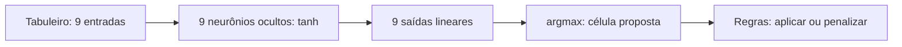
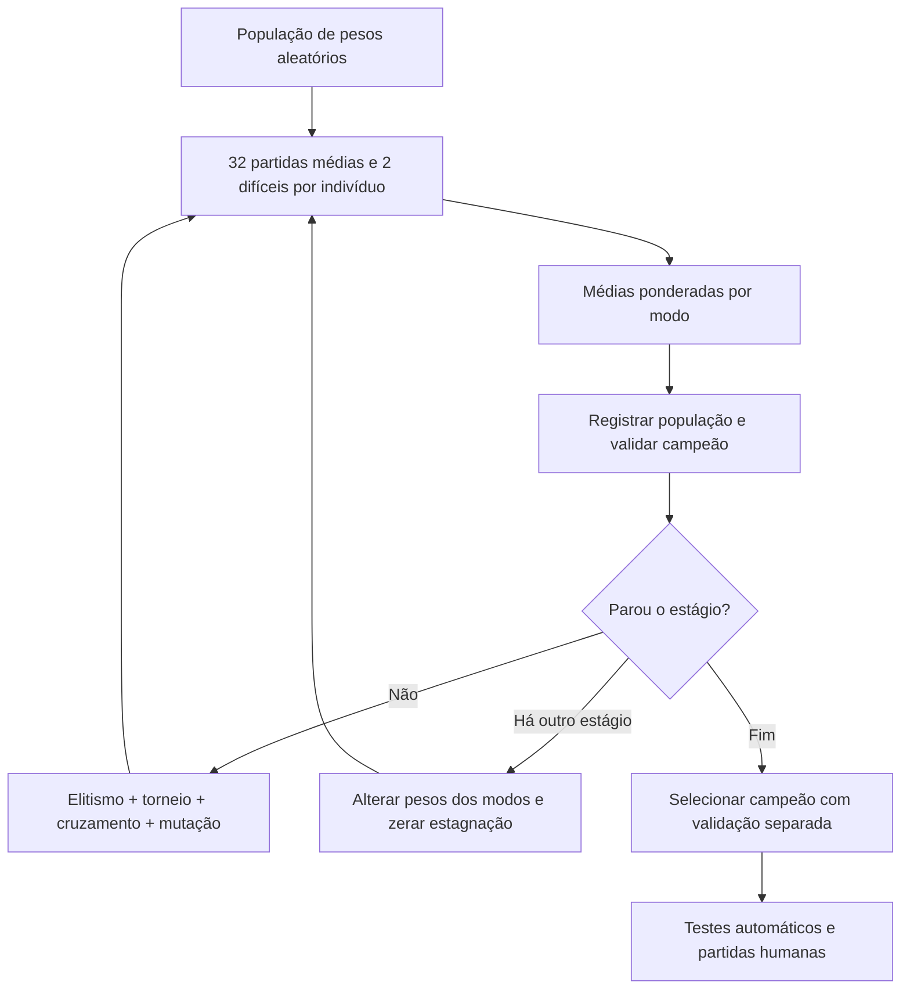

# Notas para o relatório em PPT

## Objetivo e requisitos

Aprender os pesos de uma MLP para jogar Jogo da Velha por pontuação de partidas
contra Minimax, usando exclusivamente um AG. Python e Tkinter, com algoritmos
próprios. O PDF pede duas camadas treináveis e somente propagação; não fixa os
hiperparâmetros usados aqui. Topologia inicial e referência de cruzamento devem
ser conferidas com aula/Moodle, pois não estão integralmente descritas no PDF.

A MLP 9–9–9 contém 180 pesos e bias. Duas camadas treináveis: oculta e saída.
Entrada relativa: vazio=0, próprio símbolo=1, adversário=2 (`ocupacao`).
Propagação: `h=tanh(W1·x+b1)`; `y=W2·h+b2`. Sem máscara de casas ocupadas,
gradientes, backpropagation ou consulta ao Minimax para escolher a saída da rede.

## AG e escolhas de treino

N=120; elite de 2; torneio de 3; cruzamento aritmético com probabilidade 30%;
mutação gaussiana por gene com probabilidade 2,5% e σ=0,2; limites [−5,5].
A média é de 4,5 genes mutados por filho, contra 18 na configuração anterior.
BLX continua implementado, mas o novo padrão mistura menos os pesos de redes
que já funcionam. Conferir a operação de cruzamento com a documentação Moodle.

A população inicial usa números aleatórios com viés de ocupação: cada neurônio
oculto começa sensível a uma casa, com conexão negativa para a saída correspondente.
Demais conexões também são aleatórias. Esse viés favorece legalidade; não contém
regras de vitória, bloqueio, abertura ou jogadas Minimax. Todos os 180 parâmetros
permanecem livres para o AG. É uma escolha de inicialização que deve ser explicitada
na apresentação, pois explica parte importante do ganho. A inicialização uniforme
original está disponível para comparação e para outras topologias.

Pontuação por partida: `0,05×jogadas válidas + resultado`, com vitória=3, empate=1,
derrota=−2 e inválida=−5. Invalidar encerra sem somar outra derrota. As constantes
são escolhas do projeto. Mantêm-se as mesmas da rede anterior.

Minimax médio: em cada turno, 50% de probabilidade de busca e 50% de jogada
aleatória válida. Difícil: sempre Minimax, com desempate pela primeira casa ótima.
As 34 partidas alternam 17 inícios pela rede e 17 pelo Minimax. Duas difíceis
cobrem ambos os lados desse adversário determinístico; repeti-las seria redundante.
Pesos das médias médio/difícil: 75/25 → 50/50 → 25/75. São pesos, não quantidades
de partidas. Na seleção final cada modo contribui com 50%.

O lote fixo de treino usa semente 99, com geradores independentes por partida.
O lote fixo facilita comparação e elitismo, mas pode gerar sobreajuste.
Validação por geração: semente 2026. Seleção final: semente 999, 100 partidas
médias e duas difíceis. O campeão validado é mantido entre gerações e estágios.
Máximo de 600 gerações: 300/150/150. Cada estágio para no limite ou após 100
gerações sem melhora >0,01 na validação, com mínimo de 100 por estágio.
A execução salva terminou com **397 gerações** por estagnação nos estágios.
Estagnação não prova convergência matemática.

## Comparação com a rede anterior

Configuração anterior: N=40, até 150 gerações, codificação sinal, inicialização
uniforme, BLX com probabilidade 80%, mutação 10% e σ=0,15, paciência=20.
Terminou após 100 gerações. O modelo usado na comparação está em
`resultados/rede_anterior.json`.
Novo treino: artefatos completos em `resultados/`.

Teste comparável com semente 123:

| Modelo / modo | Partidas | Vitórias | Empates | Derrotas legais | Inválidas | Decisões ótimas |
|---|---:|---:|---:|---:|---:|---:|
| Anterior / médio | 200 | 11 | 0 | 115 | 74 | 39,15% |
| Novo / médio | 200 | 93 | 67 | 35 | 5 | 85,00% |
| Anterior / difícil | 2 | 0 | 0 | 2 | 0 | 40,00% |
| Novo / difícil | 2 | 0 | 2 | 0 | 0 | 100,00% |

Para distinguir inicialização de aprendizado: o melhor indivíduo da população
inicial local, selecionado com a mesma validação 999 antes do AG, obteve 60 vitórias,
55 empates, 68 derrotas e 17 inválidas no médio; no difícil, dois empates. O AG aumentou
vitórias e empates, reduziu derrotas e jogadas inválidas e manteve os empates no difícil. Ver `avaliacao_inicial.json`.

A semente 123 foi usada em comparações exploratórias; portanto não deve ser
apresentada como teste nunca observado durante os ajustes. Após fechar a
configuração, uma amostra adicional com semente **8675309**, sem reajustes,
mediu 2.000 partidas médias por modelo:

| Modelo | Vitórias | Empates | Derrotas legais | Inválidas | Sem derrota |
|---|---:|---:|---:|---:|---:|
| Anterior | 171 | 0 | 1.041 | 788 | 8,55% |
| Novo | 780 | 771 | 391 | 58 | 77,55% |

No difícil o resultado continua sendo duas derrotas antes e dois empates depois.
O arquivo `comparacao_independente.json` permite conferir todas as métricas.
Reproduzir: `python3 t2_velha/avaliacao.py --comparar t2_velha/resultados/rede_anterior.json`.

## Estudo de robustez com quatro sementes de treino

Mesma configuração, só a semente de treino muda; avaliação com semente 8675309
(2.000 médias + 2 difíceis). Todas empataram os dois jogos difíceis.

| Semente | Vitórias | Empates | Derrotas | Inválidas | Decisões ótimas |
|---|---:|---:|---:|---:|---:|
| 42 | 674 | 509 | 782 | 35 | 69,9% |
| 7 | 614 | 709 | 646 | 31 | 74,6% |
| **99 (entregue)** | 780 | 771 | 391 | 58 | 81,7% |
| 12345 | 799 | 508 | 693 | 0 | 76,8% |

A escolha da semente 99 usou as sementes de avaliação 8675309 e 31415, logo é
otimista. Para um número limpo, avaliar numa semente nova.

## Métricas, validação e limites

Acurácia de decisão = decisões no conjunto ótimo retornado pelo Minimax / todas
as tentativas da rede; inclui a preferência por vitória rápida. Inválidas são
incorretas. Legalidade = casas livres / tentativas. Taxa de vitória = partidas
ganhas / concluídas. São métricas diferentes. Os arquivos separam início como X/O.
As métricas humanas incluem somente partidas concluídas com a mesma rede.

21 testes passaram, cobrindo regras, Minimax exaustivo, propagação numérica,
elitismo, aptidão ponderada, equivalência do cache, seleção balanceada, inicialização,
repetibilidade, convergência, interrupção, persistência e métricas humanas.
A interface carregou o novo modelo e iniciou uma partida contra ele. Uma segunda
execução integral do padrão reproduziu exatamente os 180 pesos, as avaliações e
os 397 registros de gerações (só a data muda).

A melhora não significa domínio do jogo: ainda há derrotas e propostas inválidas.
Duas partidas contra um Minimax determinístico não cobrem todas as respostas ótimas
ou todos os estados possíveis. Os ajustes combinam várias mudanças; os experimentos
exploratórios não isolam a contribuição causal de cada hiperparâmetro. Quatro sementes
de treino mostraram variação real (69,9% a 81,7% de decisões ótimas); a semente 99 foi
escolhida entre elas olhando as mesmas sementes de avaliação, então seus números são otimistas. O lote fixo pode
gerar sobreajuste. Arquivos guardam pesos e registros, sem restaurar exatamente
uma população interrompida depois de fechar a janela.

